# Inventory Kamera — Project Library & Technical Blueprint

This document is the architectural encyclopedia and technical manual for the Rust + egui rewrite and maintenance of **Inventory Kamera**. All agents must consult this reference when planning and implementing changes.

---

## 1. Project Overview & Mission

### 1.1 What is Inventory Kamera?
Inventory Kamera is an automated scanner and OCR utility for Genshin Impact on Windows. It:
1. Detects and attaches to the active Genshin Impact game window (`GenshinImpact.exe` or `YuanShen.exe`).
2. Navigates in-game menus (weapons, artifacts, characters, materials, and achievements) via simulated keyboard inputs.
3. Captures screen crops and feeds them into an optical character recognition (OCR) pipeline.
4. Validates and normalizes recognized text against static game lookup tables.
5. Exports collected data into the standardized **Genshin Open Object Description (GOOD)** JSON format for tools like Genshin Optimizer, Seelie.me, and Aspirine's Calculator.

### 1.2 Purpose of the Rust + egui Rewrite
The legacy application was built on .NET Framework 4.7.2 WinForms. The Rust + egui rewrite modernizes the software to achieve:
- **Zero Heavy Runtime Dependencies**: Completely standalone portable executable with no .NET Framework or VC++ runtime installer baggage.
- **Superior Performance & Low Latency**: Native Win32 capture, SIMD-accelerated image preprocessing, and non-blocking multi-threaded OCR queues.
- **Refined, Modern Aesthetics**: Clean, borderless, stroke-free, dark/light themed UI powered by `egui` (`eframe`).
- **Memory Safety & Reliability**: Compile-time safety guarantees, zero data races, and resilient error recovery.

---

## 2. Technology Stack

| Layer | Technology | Crates / Tools |
| :--- | :--- | :--- |
| **Language** | Rust 2021 / 2024 Edition | `rustc`, `cargo` |
| **GUI Framework** | Immediate Mode GUI (`egui`) | `eframe`, `egui` |
| **Styling** | Custom Borderless Theme System | `egui::Visuals`, `egui::Stroke::NONE`, `egui::CornerRadius` |
| **Icons** | Minimalist Monochrome Vectors | `egui_extras`, Remix Icon SVG/font assets |
| **Windows API / Interop** | Native Win32 API Interop | `windows` (Win32 Graphics, UI, Process, Direct3D/GDI) |
| **Input Simulation** | Virtual Keystroke & Mouse Driver | `windows::Win32::UI::Input::KeyboardAndMouse`, `enigo` |
| **Screen Capture** | High-performance desktop / window capture | Windows Graphics Capture API / BitBlt fallback |
| **Image Processing** | Cropping, thresholding, grayscale conversion | `image` crate |
| **OCR Recognition** | Embedded OCR engine | `tesseract-rs` (or custom fast ONNX model) with Genshin fast trained data |
| **Serialization** | JSON export (GOOD v2 format) | `serde`, `serde_json` |
| **Concurrency** | Channels, thread pools, async tasks | `crossbeam-channel`, `rayon`, `tokio` |
| **Error Handling** | Ergonomic, typed domain errors | `thiserror`, `anyhow` |

---

## 3. High-Level Architecture & Layer Separation

```mermaid
flowchart TB
    subgraph UI["Frontend UI Layer (egui / eframe)"]
        MainWindow["main_window.rs<br/>Window shell & layout"]
        ControlPanel["control_panel.rs<br/>Scan trigger, options, progress"]
        LogsPanel["logs_panel.rs<br/>Real-time log viewer & filter"]
        SettingsModal["settings_modal.rs<br/>Keybinds & resolution setup"]
        ThemeEngine["theme.rs<br/>Borderless tokens, dark/light palette"]
    end

    subgraph Core["Core & State Layer"]
        AppState["app_state.rs<br/>Shared reactive state"]
        EventBus["events.rs<br/>Cross-thread messages & cancellation"]
        Config["config.rs<br/>Persistent user settings"]
    end

    subgraph Automation["Game Automation Layer"]
        WindowDiscovery["window.rs<br/>HWND detection & aspect ratio check"]
        InputDriver["input.rs<br/>DirectInput / SendInput keystrokes"]
        CaptureDriver["capture.rs<br/>Fast window capture & sub-region cropping"]
    end

    subgraph Scrapers["Menu Scraper State Machines"]
        WeaponScraper["weapon_scraper.rs"]
        ArtifactScraper["artifact_scraper.rs"]
        CharacterScraper["character_scraper.rs"]
        MaterialScraper["material_scraper.rs"]
        AchievementScraper["achievement_scraper.rs"]
    end

    subgraph OCRLayer["OCR & Parsing Layer"]
        ImagePipeline["pipeline.rs<br/>Grayscale, thresholding, binarization"]
        OcrEngine["engine.rs<br/>Multi-threaded OCR worker pool"]
        Validator["validator.rs<br/>Dictionary lookup & fuzzy matching"]
    end

    subgraph Export["Export Layer"]
        GoodModel["good.rs<br/>GOOD v2 JSON schema definitions"]
        Exporter["exporter.rs<br/>File writer & error snapshot generator"]
    end

    MainWindow --> AppState
    ControlPanel --> AppState
    AppState --> EventBus
    EventBus -->|"Start / Stop signals"| Automation
    Automation --> Scrapers
    Scrapers -->|"Captured crops"| ImagePipeline
    ImagePipeline --> OcrEngine
    OcrEngine --> Validator
    Validator -->|"Validated items"| AppState
    AppState -->|"Scan complete"| GoodModel
    GoodModel --> Exporter
    ThemeEngine -.-> MainWindow
```



---

## 4. UI Design System Guidelines

All frontend views must strictly comply with the following design rules:

1. **Borderless & Stroke-Free**:
   - Outlines, strokes, and harsh container borders are completely prohibited (`Stroke::NONE`).
   - Grouping and separation must be achieved using subtle background elevation fills, soft contrast, and generous whitespace padding.
2. **Theme Architecture**:
   - Must provide smooth switching between **Dark Theme** and **Light Theme**.
   - Colors are defined centrally in `ui/theme.rs`.
   - Dark theme uses charcoal/slate tones (`#121316`, `#1A1D21`, `#24282F`).
   - Light theme uses soft off-white/warm neutral tones (`#F8F9FA`, `#ECEFF1`, `#E0E3E7`).
   - Accent colors are vibrant yet elegant (e.g., Genshin cyan or amber).
3. **Buttons & Controls**:
   - Flat, minimalist geometry.
   - Soft rounded corners (`CornerRadius::same(6)` to `8`).
   - Smooth hover state transitions (elevated fill tint, no border outline).
4. **Dropdowns & Selectors**:
   - Borderless, clean popups with elevated background cards and subtle shadow.
   - Clean hover states for list items.
5. **Monochrome Icons**:
   - Single-color minimalist glyphs following the Remix Icon philosophy.
   - Dynamic fill matching text/accent colors based on interactive state (idle, hover, disabled).

---

## 5. Code Standards & Modularity Rules

1. **1 File = 1 Component / Responsibility**:
   - Each file must do one thing well.
   - Do not combine UI panels, scrapers, and data models into multi-purpose files.
2. **Strict Line Ceilings**:
   - **File Ceiling**: Maximum **250 lines** per file.
   - **Function Ceiling**: Maximum **40 lines** per function.
   - Refactor sub-modules before these ceilings are reached.
3. **Core Principles**:
   - **DRY (Don't Repeat Yourself)**: Reusable components (e.g., custom borderless buttons, card containers, coordinate transformers) live in shared modules.
   - **KISS (Keep It Simple, Stupid)**: Idiomatic Rust, readable flow, minimal abstraction overhead.
   - **YAGNI (You Aren't Gonna Need It)**: Do not build speculative abstractions. Implement only what is required for current goals.
4. **Clear Comments**:
   - Every public struct, enum, trait, and function must have descriptive doc comments (`///`).
   - Document any Win32 API interactions, scaling math, or OCR thresholding parameters.

---

## 6. Directory Tree Structure (Rust Codebase)

```
Inventory_Kamera/
├── .agents/
│   └── workflows/
│       ├── architect.md             # Architect planning persona
│       ├── orchestrator.md          # Orchestrator coordination persona
│       ├── coding-specialist.md     # Coding implementation persona
│       └── code-reviewer.md         # Review and audit persona
├── AGENTS.md                        # Master operating rules for agents
├── PROJECT_LIBRARY.md               # Technical encyclopedia (this file)
├── history.md                       # History log & [MISTAKE] prevention memory
├── CHANGELOG.md                     # In-repo changelog (No blockquotes)
├── run_rust.bat                     # Consolidated 1-click dev, watch, fast, and release runner
├── Cargo.toml                       # Rust workspace & dependencies
├── src/
│   ├── main.rs                      # Application entrypoint
│   ├── app.rs                       # Top-level eframe App implementation
│   ├── core/                        # Core application state & events
│   │   ├── mod.rs
│   │   ├── state.rs                 # Shared reactive AppState (1 component)
│   │   ├── events.rs                # Cross-thread communication events
│   │   └── config.rs                # Persistent configuration loader
│   ├── ui/                          # Borderless egui frontend components
│   │   ├── mod.rs
│   │   ├── theme.rs                 # Color palettes, dark/light tokens, no-stroke
│   │   ├── icons.rs                 # Remix-style monochrome icon loaders
│   │   ├── components/              # Atomic UI widgets (1 widget per file)
│   │   │   ├── mod.rs
│   │   │   ├── button.rs            # Minimalist borderless button
│   │   │   ├── dropdown.rs          # Minimalist borderless dropdown
│   │   │   ├── card.rs              # Elevated container card (no border)
│   │   │   └── progress_bar.rs      # Flat minimalist progress indicator
│   │   └── views/                   # Main application views
│   │       ├── mod.rs
│   │       ├── header.rs            # Title bar, window controls, theme toggle
│   │       ├── control_panel.rs     # Scan start/stop and scan options
│   │       ├── preview_panel.rs     # Live OCR capture preview
│   │       ├── log_panel.rs         # Real-time scan logs with filter
│   │       └── settings_modal.rs    # Keybinds & configuration dialog
│   ├── automation/                  # Windows API automation & screen capture
│   │   ├── mod.rs
│   │   ├── window.rs                # Genshin window detection & rect scaling
│   │   ├── input.rs                 # Virtual keystroke driver (DirectInput)
│   │   └── capture.rs               # Win32 screen capture & crop extraction
│   ├── scraper/                     # Menu traversal state machines
│   │   ├── mod.rs
│   │   ├── base.rs                  # Shared scraper trait & paging logic
│   │   ├── weapon.rs                # Weapon inventory walker
│   │   ├── artifact.rs              # Artifact inventory walker
│   │   ├── character.rs             # Character inventory walker
│   │   ├── material.rs              # Material inventory walker
│   │   └── achievement.rs           # Achievement list walker
│   ├── ocr/                         # OCR engine & image preprocessing
│   │   ├── mod.rs
│   │   ├── preprocessor.rs          # Grayscale, threshold, binarization
│   │   ├── engine.rs                # Threaded OCR worker pool
│   │   └── normalizer.rs            # Text cleanup & character substitution
│   ├── data/                        # Lookup tables & dictionary validation
│   │   ├── mod.rs
│   │   ├── repository.rs            # JSON lookup table loader
│   │   ├── matcher.rs               # Fuzzy string matcher against game data
│   │   └── updater.rs               # Automatic game data updater
│   └── export/                      # Export formatting
│       ├── mod.rs
│       ├── good_format.rs           # GOOD v2 data structures
│       └── json_writer.rs           # Output file serializer
└── assets/                          # Embedded resources (icons, tessdata, lists)
```

---

## 7. Developer Experience & Run Scripts

Development is designed for rapid iteration:

- **Live / Dev Mode**:
  - Automatically compiles and executes with live console output.
  - Can be paired with `cargo watch -x run` for instant re-runs on source modification.
  - Command: `run_rust.bat dev` or `run_rust.bat watch`.
- **Fast Test Build (Fastest Compile Turnaround)**:
  - Quickly compiles an unoptimized standalone binary (`target/debug/inventory_kamera.exe`) with parallel codegen.
  - Used when testing compiled `.exe` behavior (e.g. window handles, DPI scaling, multi-threading) that live dev mode may not fully reproduce, without paying the compile-time cost of release optimization.
  - Command: `run_rust.bat fast`.
- **Smallest Portable Release Executable**:
  - Compiles a heavily size-optimized, stripped, portable standalone binary.
  - Target output: `target/release/inventory_kamera.exe`.
  - Recommended `Cargo.toml` configuration:
    ```toml
    [profile.release]
    opt-level = "z"     # Optimize for smallest binary size
    lto = true          # Full link-time optimization
    codegen-units = 1   # Maximum size reduction and dead-code elimination
    panic = "abort"     # Strip panic unwinding tables
    strip = true        # Strip debug symbols and names
    ```
  - Command: `run_rust.bat release`.

---

## 8. Source of Truth Rule

Documentation in this repository provides architectural intent and guidelines. **The live code on disk is always the primary source of truth**. When a discrepancy exists between code and documentation:
1. Trust the live code behavior.
2. Flag the discrepancy to the user or update the documentation to match the validated code.
